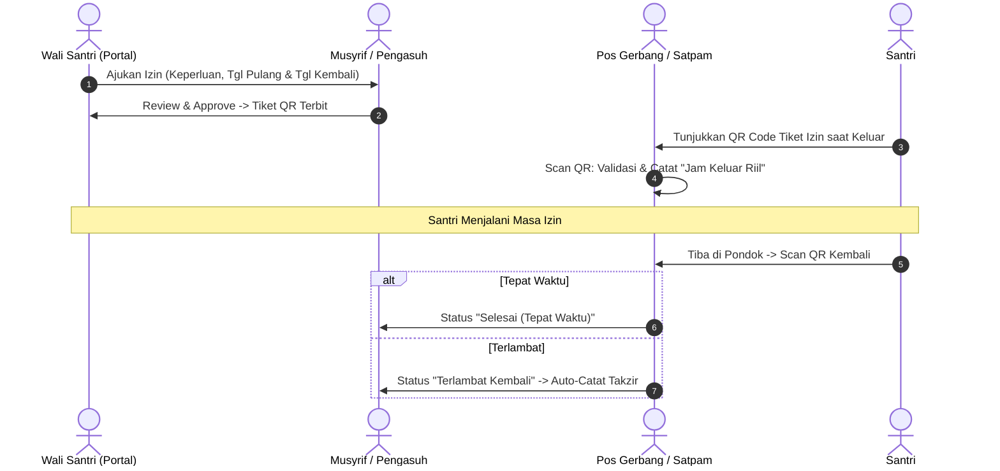

# Master Blueprint: Zadil Quran One-Stop Pesantren Platform
# Transformasi Sistem Manajemen Tahfizh Menuju SIM-Tren Modern

**Tanggal Penyusunan**: 08 November 2026 (081126)  
**Dokumen Induk**: `PRD.md`, `plans/plan-mutabaah-harian.md`  
**Status**: Rencana Strategis Arsitektur & Implementasi (Phase 1 - Phase 3)

---

## 1. Visi Produk & Ringkasan Eksekutif

Zadil Quran bertransformasi dari sistem pencatatan tahfizh Al-Qur'an menjadi **One-Stop Pesantren Platform (Sistem Informasi Manajemen Pesantren Terpadu / SIM-Tren)**. 

Pesantren adalah ekosistem 24 jam dengan kebutuhan tata kelola yang terintegrasi:
1. **Pendidikan & Spiritual**: Tahfizh Al-Qur'an, Diniyyah/Kitab, Mutaba'ah Ibadah Harian.
2. **Administrasi & Data Pokok**: Buku Induk Santri, Data Asatidz, Penempatan Kamar/Asrama.
3. **Finansial & Billing**: SPP, Uang Makan, Daftar Ulang, Arus Kas (Cashflow), dan Notifikasi WhatsApp.
4. **Keamanan & Ketertiban**: E-Izin Gerbang (Scan QR Satpam) dan Catatan Kedisiplinan/Adab (E-Takzir).
5. **Kesehatan**: Rekam Medis Santri di Poskestren/UKS.
6. **Portal Wali Santri 360°**: Satu pintu bagi orang tua untuk memantau hafalan, bayar SPP, ajukan izin pulang, dan cek kondisi anak.

---

## 2. Peta Modul & Skema Database Terintegrasi

Sistem dirancang modular dan bertahap. Pada tahap awal tetap menggunakan **Google Sheets API via Google Apps Script (`code.gs`)** yang dioptimalkan, dengan skema data relasional yang siap dimigrasikan ke PostgreSQL/Supabase saat skala santri bertumbuh.

```text
┌─────────────────────────────────────────────────────────────────────────────┐
│                    ZADIL QURAN - CORE ECOSYSTEM ARCHITECTURE                │
├─────────────────────────────────────────────────────────────────────────────┤
│  [ PORTAL WALI SANTRI ]     [ WORKSPACE USTADZ ]     [ DASHBOARD ADMIN/TU ] │
│  • Pantau Hafalan Anak      • Smart Form Tahfizh     • Buku Induk Santri/Guru│
│  • Bayar SPP & Tagihan      • Binnadhor & Ziyadah    • Manajemen Tagihan SPP│
│  • E-Izin Pulang & Sakit    • Mutabaah Yaumiyah      • Keuangan & Buku Kas  │
│  • Riwayat Adab & Sehat     • Evaluasi Makhraj       • Laporan & Persuratan │
├─────────────────────────────────────────────────────────────────────────────┤
│                       MODUL OPERASIONAL KHAS PESANTREN                      │
│   [E-Izin & QR Gerbang]    [E-Takzir & Poin Adab]    [Poskestren / Medis]   │
├─────────────────────────────────────────────────────────────────────────────┤
│                    DATABASE & CLOUD ENGINE (SERVERLESS)                     │
│    Google Sheets Engine (GAS API)  ──>  Cloudflare Edge Pages / Workers     │
│    WhatsApp Gateway (Fonnte/Wablas) ──>  Payment Gateway (QRIS/Transfer)   │
└─────────────────────────────────────────────────────────────────────────────┘
```

---

## 3. Detail Rancang Bangun Modul Utama

### MODUL 1: Buku Induk Santri, PSB 2 Jalur & Asatidz (Master Data) — [TELAH DIIMPLEMENTASIKAN DI V4.0]

#### A. Skema Sheet `Data_Santri` (27 Kolom Sesuai Formulir Fisik PPTQ Zadil Qur'an):
| Kolom | Tipe | Keterangan |
| :--- | :--- | :--- |
| `ID_Santri` | String (PK) | Prefix wajib **`ZQ-`** — Contoh: `ZQ-2026-X8K9` (Unique ID) |
| `Nama_Santri`| String | Nama lengkap santri sesuai akta kelahiran |
| `Nama_Panggilan` | String | Nama panggilan akrab di pondok |
| `Jenis_Kelamin` | String | `Laki-laki (Putra)` / `Perempuan (Putri)` |
| `Tempat_Lahir`| String | Kota/Kabupaten tempat lahir |
| `Tanggal_Lahir` | String | Tanggal lahir |
| `Alamat` | String | Nama jalan, gang, atau dusun |
| `RT` / `RW` | String | Nomor RT dan RW |
| `Desa` / `Kecamatan` | String | Kelurahan/Desa dan Kecamatan |
| `Kab_Kota` / `Provinsi` | String | Kabupaten/Kota dan Provinsi |
| `Pendidikan_Terakhir` | String | Jenjang pendidikan sebelum masuk pondok |
| `Tahun_Lulus` | String | Tahun kelulusan pendidikan terakhir |
| `Sekolah_Asal` | String | Nama sekolah asal |
| `Nama_Ayah`, `Pekerjaan_Ayah`, `Pendidikan_Ayah` | String | Data lengkap Ayah kandung |
| `Nama_Ibu`, `Pekerjaan_Ibu`, `Pendidikan_Ibu` | String | Data lengkap Ibu kandung |
| `Nama_Wali` | String | Nama wali yang bertanggung jawab |
| `No_HP_Wali` | String | Nomor telepon/WhatsApp orang tua atau wali |
| `ID_Ustadz` | String | ID Ustadz pengampu tahfizh |
| `Status` | String | `Aktif`, `Calon Santri`, `Alumni`, `Cuti` |
| `Timestamp` | String | Waktu pencatatan pendaftaran |

#### B. Dua Jalur Pengisian Buku Induk Santri:
1. **Jalur Online (Mandiri oleh Wali Santri di Landing Page `#form-pendaftaran`)**:
   - Menampilkan **7 Syarat Pendaftaran Santri Mukim** (Komitmen 30 Juz, Mengisi formulir, Foto 3x4 3 lembar, FC Ijazah/Raport/KK/Akta 2 lembar, Surat Keterangan Kematian Ortu bagi yatim/piatu, Sanggup taat tata tertib, Diantar Wali Santri).
   - Menampilkan **Rincian Biaya Pendaftaran**:
     - **A. Pendaftaran**: Pendaftaran (`Rp 100.000`) + Almari (`Rp 500.000`) + Infaq Gedung (`Rp 1.000.000`) + Kesehatan (`Rp 100.000`) + Kitab & Buku Panduan (`Rp 100.000`) = **`Rp 1.800.000`**.
     - **B. Syahriyah (SPP Bulanan)**: **`Rp 200.000`**.
     - **Total Awal Masuk**: **`Rp 2.000.000`**.
   - Otomatis menerbitkan Kode **`ZQ-2026-XXXX`** dan membuat 2 tagihan awal di `Data_Tagihan`.
2. **Jalur Admin (Melalui Dashboard Superadmin `/admin/santri`)**:
   - Admin dapat menambah, mengedit, melihat detail lembar Buku Induk, memfilter berdasarkan status (`Calon Santri`, `Aktif`, `Alumni`, `Cuti`), dan memplot Ustadz Pembimbing.

#### B. Skema Sheet `Users_Ustadz` (Diperluas):
| Kolom | Tipe | Keterangan |
| :--- | :--- | :--- |
| `ID_Ustadz` | String (PK) | Contoh: `U-001` |
| `Nama_Lengkap`| String | Nama ustadz beserta gelar |
| `Username` | String | Akun login aplikasi |
| `Password` | String | Password terenkripsi/hash |
| `No_WA` | String | Nomor WhatsApp ustadz |
| `Role_Tugas` | String | `Guru Tahfizh`, `Musyrif Asrama`, `Guru Diniyyah`, `Kombinasi` |
| `Sanad_Tahfizh`| String | Riwayat sanad hafalan & metode (Ummi/Darul Quran/dll) |
| `Status_Kerja`| String | `Tetap`, `Tugas Belajar`, `Pengabdian` |

#### C. Skema Sheet `Master_Kamar`:
| Kolom | Tipe | Keterangan |
| :--- | :--- | :--- |
| `ID_Kamar` | String (PK) | Contoh: `KMR-01` |
| `Nama_Kamar` | String | Contoh: "Abu Bakar Ash-Shiddiq Lantai 2" |
| `Kapasitas` | Number | Jumlah kasur/kuota santri (misal: 12) |
| `ID_Musyrif` | String | Ustadz/Musyrif penanggung jawab kamar |

---

### MODUL 2: Keuangan, Tagihan SPP & Arus Kas (Billing & Cashflow)

#### A. Skema Sheet `Keuangan_Pos_Tarif` (Master Jenis Tagihan):
| Kolom | Tipe | Keterangan |
| :--- | :--- | :--- |
| `ID_Tarif` | String (PK) | Contoh: `TRF-SPP-2026` |
| `Nama_Tarif` | String | Contoh: "SPP & Uang Makan Bulanan" |
| `Tipe_Periode`| String | `Bulanan`, `Semester`, `Tahunan`, `Sekali Bayar` |
| `Nominal_Default`| Number | Nilai tagihan standar (contoh: `750000`) |

#### B. Skema Sheet `Keuangan_Tagihan`:
| Kolom | Tipe | Keterangan |
| :--- | :--- | :--- |
| `ID_Tagihan` | String (PK) | Contoh: `INV-202611-ST001` |
| `ID_Santri` | String (FK) | Relasi ke santri |
| `ID_Tarif` | String (FK) | Relasi ke jenis tarif |
| `Bulan_Tahun` | String | Contoh: "November 2026" |
| `Nominal_Tagihan`| Number | Jumlah yang harus dibayar |
| `Potongan` | Number | Beasiswa/diskon khusus (misal santri berprestasi) |
| `Total_Harus_Bayar`| Number| Nominal bersih setelah diskon |
| `Status` | String | `Belum Bayar`, `Menunggu Verifikasi`, `Lunas`, `Tercicil` |
| `Tgl_Jatuh_Tempo`| String | Batas akhir pembayaran (misal tgl 10 tiap bulan) |

#### C. Skema Sheet `Keuangan_Pembayaran`:
| Kolom | Tipe | Keterangan |
| :--- | :--- | :--- |
| `ID_Bayar` | String (PK) | Contoh: `BYR-1731056789` |
| `ID_Tagihan` | String (FK) | Relasi ke tagihan |
| `Tgl_Bayar` | String | Tanggal transaksi |
| `Nominal_Bayar`| Number | Jumlah uang yang ditransfer/disetor |
| `Metode` | String | `Transfer Bank BSI`, `QRIS`, `Tunai di Kantor TU` |
| `Bukti_Transfer`| String | URL foto/dokumen slip transfer dari wali |
| `Status_Verifikasi`| String| `Pending`, `Disetujui`, `Ditolak` |
| `Verified_By` | String | Nama bendahara yang memvalidasi |
| `Catatan` | String | Catatan bendahara |

#### D. Skema Sheet `Keuangan_Kas_Pesantren` (Buku Kas Umum):
| Kolom | Tipe | Keterangan |
| :--- | :--- | :--- |
| `ID_Kas` | String (PK) | Contoh: `KAS-2026-001` |
| `Tgl` | String | Tanggal transaksi kas |
| `Kategori` | String | `Pemasukan (SPP)` / `Pemasukan (Donasi/Infaq)` / `Pengeluaran (Operasional)` |
| `Deskripsi` | String | Contoh: "Belanja logistik beras & sayur asrama pekan ke-2" |
| `Nominal_Masuk`| Number | Debet (0 jika keluar) |
| `Nominal_Keluar`| Number | Kredit (0 jika masuk) |
| `Saldo_Akhir` | Number | Saldo berjalan |
| `Admin_PJ` | String | Nama staf kasir |

---

### MODUL 3: E-Izin Gerbang & Perizinan Pulang (Gate Pass QR)

Mekanisme perizinan santri merupakan titik rawan keamanan pesantren.



#### Skema Sheet `Data_Perizinan`:
| Kolom | Tipe | Keterangan |
| :--- | :--- | :--- |
| `ID_Izin` | String (PK) | Contoh: `IZN-2026-0881` |
| `ID_Santri` | String (FK) | Relasi ke santri |
| `Jenis_Izin` | String | `Pulang / Libur`, `Berobat / Sakit`, `Pesiar / Keperluan Keluarga` |
| `Alasan` | String | Alasan detail izin |
| `Rencana_Keluar`| String | Tanggal & jam rencana keluar |
| `Rencana_Kembali`| String| Batas maksimal wajib tiba di pondok |
| `Status_Approval`| String| `Menunggu Persetujuan`, `Disetujui`, `Ditolak` |
| `Approved_By` | String | Nama ustadz/pengasuh yang mengesahkan |
| `Waktu_Keluar_Riil`| String | Jam saat scan QR satpam keluar |
| `Waktu_Kembali_Riil`| String| Jam saat scan QR satpam kembali |
| `Status_Kepulangan`| String| `Belum Kembali`, `Tepat Waktu`, `Terlambat` |

---

### MODUL 4: Kedisiplinan & Poin Adab (E-Takzir & Prestasi)

Menerapkan sistem poin yang transparan agar orang tua memahami pembinaan karakter santri di pondok.

#### Skema Sheet `Data_Kedisiplinan`:
| Kolom | Tipe | Keterangan |
| :--- | :--- | :--- |
| `ID_Catatan` | String (PK) | Contoh: `ADAB-2026-0042` |
| `ID_Santri` | String (FK) | Relasi ke santri |
| `Tipe` | String | `Pelanggaran (Takzir)` atau `Prestasi (Kebaikan)` |
| `Kategori` | String | `Ringan`, `Sedang`, `Berat` |
| `Peristiwa` | String | Contoh: "Terlambat Shalat Subuh Berjamaah" atau "Juara 1 MHQ 5 Juz" |
| `Poin` | Number | Poin minus (misal: -10) atau poin plus (+20) |
| `Bentuk_Takzir`| String| Sanksi edukatif (misal: setoran hafalan tambahan 1 halaman, membersihkan perpustakaan) |
| `Status_Takzir`| String| `Belum Selesai`, `Tuntas Dijalani` |
| `Musyrif_Pencatat`| String| Nama ustadz pembina |
| `Tgl` | String | Tanggal kejadian |

---

### MODUL 5: Poskestren / UKS Digital (Kesehatan Santri)

Memberikan rasa aman dan tenang bagi wali santri jarak jauh.

#### Skema Sheet `Data_Kesehatan`:
| Kolom | Tipe | Keterangan |
| :--- | :--- | :--- |
| `ID_RekamMedis`| String (PK)| Contoh: `MED-2026-015` |
| `ID_Santri` | String (FK) | Relasi ke santri |
| `Tgl_Periksa` | String | Tanggal berobat |
| `Keluhan` | String | Contoh: "Demam 38.5°C, pusing, batuk pilek" |
| `Diagnosa_Awal`| String | Contoh: "Gejala Flu / Radang" |
| `Tindakan` | String | `Istirahat di Kamar UKS`, `Diberi Obat & Kembali ke Kamar`, `Dirujuk ke RS/Klinik` |
| `Obat_Diberikan`| String | Nama obat dan dosis |
| `Status_Sembuh`| String | `Dalam Perawatan`, `Sembuh/Selesai` |
| `Petugas_Medis`| String | Nama petugas Poskestren |

---

## 4. Cetak Biru Antarmuka (Wireframe User Interface)

### A. Dashboard Tata Usaha & Bendahara (Multi-Tab Admin)
```text
┌────────────────────────────────────────────────────────────────────────┐
│ 🏛️ ZADIL QURAN - PUSAT KENDALI OPERASIONAL PESANTREN                    │
├────────────────────────────────────────────────────────────────────────┤
│ [ Ringkasan ] [ Buku Induk ] [ SPP & Keuangan ] [ Izin & Asrama ] [⚙️] │
├────────────────────────────────────────────────────────────────────────┤
│ 📊 STATISTIK HARI INI:                                                 │
│ ┌───────────────┬───────────────┬────────────────┬───────────────────┐ │
│ │ Total Santri  │ Hafalan Hari  │ Tagihan Lunas  │ Santri Izin Keluar│ │
│ │  142 Santri   │  48 Setoran   │ Rp 82.500.000  │  6 Santri         │ │
│ └───────────────┴───────────────┴────────────────┴───────────────────┘ │
│                                                                        │
│ 🔔 PERLU TINDAKAN CEPAT:                                               │
│ • [4] Bukti Transfer SPP Menunggu Verifikasi Bendahara     [ Periksa ] │
│ • [2] Permohonan Izin Pulang Menunggu Approval Pengasuh    [ Tinjau  ] │
│ • [1] Santri Sedang Dirawat di Poskestren                  [ Detail  ] │
└────────────────────────────────────────────────────────────────────────┘
```

### B. Portal All-in-One Wali Santri (Mobile View)
```text
┌──────────────────────────────────────────────────┐
│ 🕌 ZADIL QURAN - PORTAL WALI SANTRI              │
│ Santri: Muhammad Ziyad (NIS: 20260104)           │
├──────────────────────────────────────────────────┤
│ 📖 CAPAIAN TAHFIZH:                              │
│ • Progress: 4 Juz 12 Lembar (Terakhir: An-Naba)  │
│ • Setoran Terakhir: Kemarin, Sesi Sore (Mumtaz)  │
│                                                  │
│ 💳 STATUS BIAYA SPP:                             │
│ • November 2026: Rp 750.000 [ LUNAS ✅ ]         │
│ • Desember 2026: Rp 750.000 [ BELUM DIBAYAR ⚠️ ] │
│   [ Bayar Sekarang / Upload Bukti Transfer ]     │
│                                                  │
│ 🚪 PERIZINAN & KEPULANGAN:                       │
│ • Tiket Aktif: Tidak Ada                         │
│   [ + Ajukan Izin Pulang / Pesiar ]              │
│                                                  │
│ 🏥 CATATAN KESEHATAN & ADAB:                     │
│ • Kondisi: Sehat Walafiat                        │
│ • Poin Kebaikan: +35 (Tanpa Catatan Pelanggaran) │
└──────────────────────────────────────────────────┘
```

---

## 5. Rencana Fase Rilis (Roadmap Bertahap)

| Fase | Target Waktu | Fokus Pengembangan | Output Nyata |
| :--- | :--- | :--- | :--- |
| **Fase 1 (Tahfizh & Master Data)** | Sprint 1-2 | • Selesaikan Smart Form Setoran Harian (Ziyadah, Murojaah, Binnadhor)<br>• Perluas Sheet `Data_Santri` & `Users_Ustadz` jadi Buku Induk Lengkap<br>• Modal detail profil santri & cetak KTS sederhana | Guru tahfizh nyaman menginput; data santri rapi 100%. |
| **Fase 2 (Billing & Keuangan)** | Sprint 3-4 | • Modul Tagihan SPP & Kas Masuk/Keluar<br>• Upload Bukti Bayar di Portal Wali<br>• Dashboard Verifikasi Bendahara & Cetak Kwitansi PDF | Keuangan pesantren tertib; tunggakan terpantau jelas. |
| **Fase 3 (Asrama & Perizinan)** | Sprint 5-6 | • E-Izin Pulang/Pesiar dengan QR Code<br>• Scanner Interface untuk Satpam Pos Gerbang<br>• Mutaba'ah Yaumiyah & Catatan Takzir Adab | Keamanan santri terjaga 24 jam; orang tua merasa tenang. |
| **Fase 4 (Automasi & Modernisasi)** | Masa Depan | • Integrasi Gateway Notifikasi WhatsApp (Fonnte)<br>• Payment Gateway QRIS Otomatis (Midtrans/Tripay)<br>• Tabungan Uang Saku Digital (Cashless Kantin) | Pesantren naik kelas menjadi pesantren modern digital. |

---

*Dokumen ini merupakan acuan resmi pengembangan Zadil Quran versi One-Stop Platform.*

